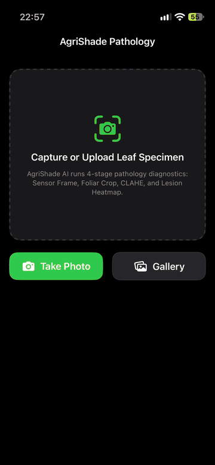

# 🌿 AgriShade: Intelligent Crop Pathology & Agro-Ecological Management System

AgriShade is an end-to-end precision agriculture and foliar disease diagnostic platform comprising an **on-device iOS neural vision application**, an **enterprise FastAPI cloud backend**, and an **edge-synchronization service**.

---

## 📱 Live iOS Mobile Demonstration

<div align="center">
  <a href="docs/assets/agrishade_ios_demo.mp4">
    
  </a>
  <p align="center">
    <b>Real-time foliar pathology inference on Apple iPhone</b><br/>
    <i>100% on-device Core ML execution (Apple Neural Engine), Cell 6 4-Panel Diagnostic HUD, Shannon Entropy Fail-Safe Safety Lock, and Agronomic Prescription Advisory.</i>
  </p>
  <p align="center">
    <a href="docs/assets/agrishade_ios_demo.mp4"><strong>▶️ Play / Download High-Definition Demo Video (.mp4 • 60 FPS • 2.0 MB)</strong></a>
  </p>
</div>

---

## 🌟 System Architecture

```
┌─────────────────────────────────────────────────────────────┐
│                    AgriShade Ecosystem                      │
└─────────────────────────────────────────────────────────────┘
                               │
         ┌─────────────────────┼─────────────────────┐
         ▼                                           ▼
┌─────────────────────────┐               ┌─────────────────────────┐
│     iOS Mobile App      │               │     Backend & Cloud     │
│   (SwiftUI + Core ML)   │               │   (FastAPI + SQLite)    │
├─────────────────────────┤               ├─────────────────────────┤
│ • 100% On-Device Neural │               │ • RESTful Pathology API │
│   Inference (38 classes)│               │ • Field Sensor Telemetry│
│ • Apple Neural Engine   │               │ • Soil & Weather Sync   │
│ • Cell 6 4-Panel HUD    │               │ • JWT Auth & RBAC       │
│ • Fail-Safe Lock        │               │ • Docker & Compose      │
│ • Agronomic Advisory    │               │ • Security Tests        │
└─────────────────────────┘               └─────────────────────────┘
```

---

## 📁 Repository Structure

```
.
├── ios/
│   └── AgriShadeApp/
│       ├── AgriShade.xcodeproj       # Native Xcode Project
│       └── AgriShadeApp/
│           ├── AgriShadeApp.swift     # SwiftUI app lifecycle entry point
│           ├── AgriShadeNet.swift     # Core ML Swift interface
│           ├── AgriShadeNet.mlpackage # Converted Core ML model (38 classes)
│           ├── AgriShadeNet.mlmodelc/ # Pre-compiled Core ML model binary
│           ├── Models/
│           │   └── PathologyModel.swift # Botanical taxonomy & agronomic database
│           ├── Services/
│           │   ├── FoliarValidator.swift         # OOD non-leaf filter
│           │   ├── FoliarDiagnosticService.swift # Neural inference & fail-safe
│           │   └── Cell6DiagnosticPipeline.swift # 4-panel diagnostic generator
│           └── Views/
│               ├── ContentView.swift              # Main camera/gallery interface
│               ├── Cell6DiagnosticDashboard.swift # Cell 6 4-panel diagnostic HUD
│               ├── DiagnosticReportCard.swift     # Prescription advisory card
│               └── ImagePickerSheet.swift         # PHPicker & camera sheet
│
├── backend/
│   ├── main.py                       # FastAPI application & API endpoints
│   ├── models.py                     # SQLAlchemy ORM models
│   ├── schemas.py                    # Pydantic schemas & request validation
│   ├── database.py                   # SQLite engine & session management
│   ├── security.py                   # Password hashing, JWT token authentication
│   ├── seed_data.py                  # Initial demo data & agricultural sensors
│   ├── test_queries.py               # Database verification queries
│   ├── Dockerfile                    # Containerization for FastAPI service
│   ├── requirements.txt              # Python backend dependencies
│   └── agrishadenet_database.sql     # Database schema & initial dump
│
├── edge/
│   ├── edge_db.py                    # Local edge database buffer
│   ├── edge_scanner.py               # Field IoT sensor scanner
│   └── edge_sync_client.py           # Cloud synchronization client
│
├── security/
│   └── test_sql_injection.py         # Security & SQL injection vulnerability suite
│
├── docs/
│   ├── assets/                       # Demo media (H.264 MP4 demo & preview GIF)
│   ├── submission_package/           # ICT Assignment 4 competition deliverables
│   └── RESEARCH_IMPROVEMENTS.md      # Agronomic & algorithmic enhancement roadmaps
│
├── docker-compose.yml                # Multi-service container orchestration
├── AgriShade.ipynb                   # Model training, Grad-CAM, & Cell 6 pipeline
└── convert_to_coreml.py              # PyTorch to Core ML conversion script
```

---

## 🚀 Getting Started

### 1. iOS App (iPhone / Simulator)
1. Open the project in Xcode:
   ```bash
   open ios/AgriShadeApp/AgriShade.xcodeproj
   ```
2. Connect your iPhone via USB or select a Simulator.
3. Under **Signing & Capabilities**, select your personal Apple ID team.
4. Press **Run (`⌘R`)**.

### 2. Backend API
1. Create and activate a Python virtual environment:
   ```bash
   cd backend
   python3 -m venv .venv
   source .venv/bin/activate
   pip install -r requirements.txt
   ```
2. Seed the database:
   ```bash
   python seed_data.py
   ```
3. Run the FastAPI development server:
   ```bash
   uvicorn main:app --reload --host 0.0.0.0 --port 8000
   ```
4. Access interactive API documentation at: `http://localhost:8000/docs`.

### 3. Running with Docker Compose
```bash
docker-compose up --build
```

---

## 🔒 Security & Quality Gates
- **Foliar Leaf Pre-Screening**: Rejects non-plant photos (furniture, electronics, humans) before disease inference.
- **Fail-Safe Safety Lock**: Suppresses chemical pesticide advice when confidence is $<65\%$ or entropy $>1.75$ nats to prevent crop phytotoxicity.
- **SQL Injection Guard**: Verified with `security/test_sql_injection.py`.
- **JWT & Role-Based Access Control**: Enforced across all cloud administrative endpoints.
